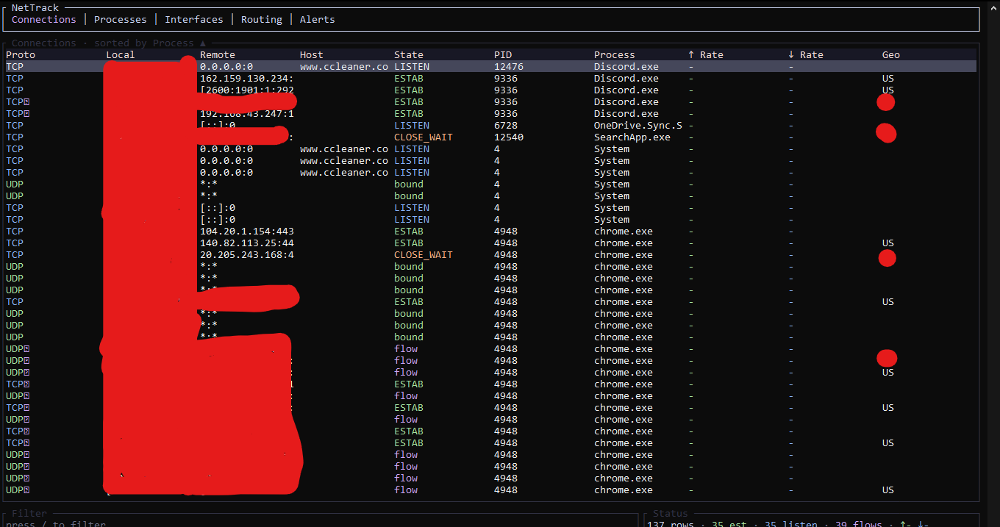

# NetTrack - Real-time Network Monitor for Windows

A terminal-based (TUI) network monitor for Windows that shows which applications connect to which IP addresses and ports over TCP and UDP, with live byte rates, process attribution, hostnames, country flags for remote peers, and configurable alerts.

## Features

- **Live network monitoring**: Track TCP and UDP connections in real-time
- **Process attribution**: Show which process owns each connection
- **Byte rates**: Display upload/download rates per connection
- **Country flags**: GeoIP lookup for remote peer countries
- **Hostname resolution**: Display remote hostnames via DNS cache
- **ETW kernel tracing**: Live UDP peer endpoints and connection events
- **Per-connection TCP stats**: Extended statistics for byte counting
- **Administrator elevation**: Required for full ETW/UDP peer visibility
- **Configurable alerts**: Set alerts for specific conditions
- **Headless mode**: Scriptable output in text or JSON format
- **Mouse support**: Click tabs, hover rows, select connections

### Preview


## Requirements

- Windows 10 1809+ (version 17763 or later)
- x64 architecture
- Administrator rights recommended for full ETW kernel tracing and per-connection TCP statistics
- Npcap (optional, for TLS SNI/HTTP host identification via `--features npcap`)

## Build Instructions

This project uses Rust with a self-contained llvm-mingw toolchain for static linking. No MinGW runtime DLLs are required - the binary is fully portable.

### Prerequisites

- Rust stable-x86_64-pc-windows-gnu 1.99.1+
- llvm-mingw toolchain at `C:\Users\jolop\.local\toolchains\llvm-mingw`
- GeoLite2-Country.mmdb database (downloaded at build time from P3TERX mirror)

### Building

```powershell
# Clone the repository
git clone <repository-url>
cd nettrack

# Build release binary
cargo build --release
```

The release binary (`nettrack.exe`) is approximately 2.28 MB and imports only Windows system DLLs (ntdll, kernel32, iphlpapi, etc.) - fully portable single executable.

## Usage

### Interactive Mode

```powershell
# Run as Administrator for full features (ETW, UDP peers, QUIC)
.\nettrack.exe

# Run without administrator (limited - local sockets only)
.\nettrack.exe --no-elevation
```

### Headless / Script Mode

```powershell
# Print one snapshot and exit
.\nettrack.exe --headless

# Print as JSON
.\nettrack.exe --headless --json

# Collect N samples before printing
.\nettrack.exe --headless --samples 5

# Test ETW connectivity
.\nettrack.exe --diag-etw

# Run without elevation request
.\nettrack.exe --headless --no-elevation -n 3
```

### Keyboard Shortcuts

| Key | Action |
|-----|--------|
| `q` | Quit |
| `Tab` / `Shift+Tab` | Switch tabs |
| `1`-`5` | Jump to tab 1-5 |
| `j` / `k` / `Up` / `Down` | Navigate up/down |
| `Enter` | Show connection details |
| `/` | Filter connections |
| `s` | Change sort column |
| `Space` | Pause/resume |
| `?` | Show help |

### Mouse Support (when enabled)

- Click tab labels to switch tabs
- Hover over rows to highlight
- Click rows to select

## ETW & Administrator Rights

Windows ETW (Event Tracing for Windows) kernel tracing requires Administrator rights for full functionality:

- **Without elevation**: Only local sockets visible, ETW shows `active=false, seen=0, dropped=0`
- **With elevation**: UDP peers captured (YouTube/QUIC on port 443), cross-user process details visible
- The status bar clearly indicates: `"NOT ELEVATED - run as Administrator to see UDP peers (YouTube/QUIC)"`

Run `.\nettrack.exe --diag-etw` to test ETW connectivity.

## Release Package

The release package includes:
- `nettrack.exe` - Fully portable executable (2.28 MB)
- `GeoLite2-Country.mmdb` - GeoIP database
- `SHA256SUMS.txt` - Checksums for verification

## License

MIT